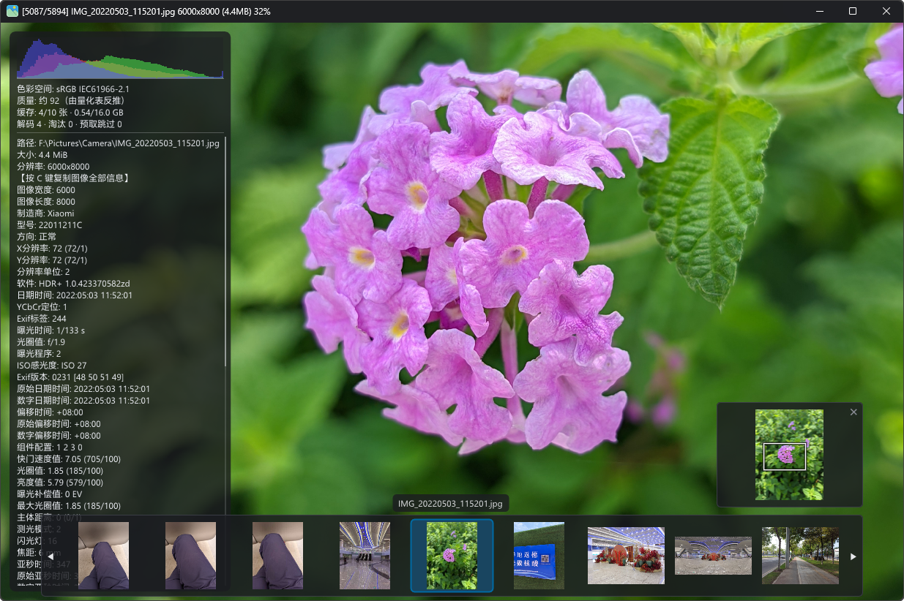
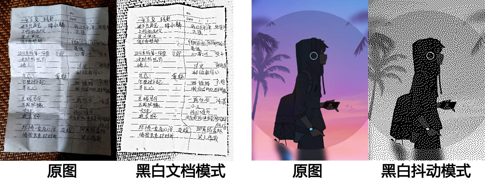

<p align="center">
  
</p>

<h1 align="center">🖼️ JarkViewer 看图</h1>

<p align="center">
  <a href="https://github.com/jark006/JarkViewer/releases"></a>
  <a href="https://github.com/jark006/JarkViewer/releases"></a>
  
  <a href="LICENSE"></a>
  <a href="https://deepwiki.com/jark006/JarkViewer"></a>
  <a href="https://zread.ai/jark006/JarkViewer" target="_blank"></a>
</p>

<p align="center">
  中文 | <a href="README_EN.md">English</a>
</p>

**JarkViewer** 是一款原生 Windows 看图软件，集图片浏览、编辑标注、批量处理与视频 / 音频播放于一体。

<p align="center">
  <a href="https://github.com/jark006/JarkViewer/releases/latest"><strong>下载最新版</strong></a> ·
  <a href="#-安装与系统要求">安装方式</a> ·
  <a href="#-常用操作">操作指南</a> ·
  <a href="#-格式支持">支持格式</a>
</p>

## ✨ 核心亮点

- **绿色便携**：主程序单文件运行，免安装；自 `v2.0` 起无需额外安装 VC++ 运行库。
- **格式丰富**：支持 JPEG / PNG、HEIC / AVIF / JPEG XL、相机 RAW、动图与实况照片。
- **大图浏览**：后台解码、缩略图与相邻图片预读，画面静止后按显示分辨率重采样。
- **色彩与信息**：ICC 色彩管理、EXIF，以及 AI 生图提示词与工作流查看。
- **编辑与批处理**：裁剪、标注、格式转换、缩放、旋转与重命名。
- **媒体播放**：独立视频 / 音频播放器，支持视频硬件解码、进度拖动与音频频谱。



主窗口：左侧为 EXIF 信息，底部为同目录缩略图带，右下角为鸟瞰图。

## 🚀 安装与系统要求

支持 **Windows 10 / 11 x64**。以下三种获取方式任选其一。

### 📥 直接下载

从 [GitHub Releases](https://github.com/jark006/JarkViewer/releases/latest) 下载并运行 `JarkViewer.exe`；压缩包请先解压。

备用下载：[SourceForge 镜像](https://sourceforge.net/projects/jarkviewer.mirror/)、[蓝奏网盘](https://jark006.lanzout.com/b0ko7mczg)、[百度网盘](https://pan.baidu.com/s/1ka7p__WVw2du3mnOfqWceQ?pwd=6666)（网盘提取码：`6666`）。

主程序可独立运行；资源管理器缩略图功能需要将附带的 `JarkThumbnailProvider.dll` 保留在主程序同一目录，注册方式见[文件管理与格式关联](#-文件管理与格式关联)。

### 📦 Winget

```powershell
winget install jark006.jarkviewer
```

### 🥄 Scoop

```powershell
scoop bucket add extras
scoop install extras/jarkviewer
```

<details>
<summary>🖥️ 旧版系统与运行环境</summary>

- Windows 8 / 8.1 x64 已有运行验证，但不保证后续版本继续兼容。
- 不支持 32 位系统、Windows 7 及更早版本。
- 自 `v2.0` 起全部依赖静态链接，无需额外安装 VC++ 运行库，也可在 Windows PE 环境运行。遇到缺失 DLL 错误时，请确认下载了正确的发布版本。

</details>

## 🧭 常用操作

把图片拖进窗口、按 `Ctrl + O` 选择文件，或通过命令行传入文件路径即可打开。一次拖入多个文件时只打开第一个；图片可在同目录翻页。

| 操作 | 方式 |
| --- | --- |
| 切换图片 | `←` `→`，或在窗口左右边缘单击 / 滚轮 |
| 缩放 | 窗口中间滚轮；数字小键盘 `5` 切换 `1:1` / 适应窗口 |
| 平移 | 鼠标拖动，或 `W` `A` `S` `D` |
| 图像信息（EXIF） | 鼠标中键、`TAB` 或 `I` |
| 全屏 | 双击窗口、`F` 或 `F11` |
| 退出 | `ESC` 或 `Ctrl + W` |

<details>
<summary>⌨️ 完整看图操作与快捷键</summary>

| 操作 | 方式 |
| --- | --- |
| 切换图片 | 窗口左右边缘 `单击/滚轮`、`←` `→`、`PgUp` `PgDn`、`空格`（静态图时切下一张） |
| 缩放 | 窗口中间 `滚轮`、`↑` `↓`；`5`（数字小键盘 `5`）在 `1:1` 与「适应窗口」之间切换 |
| 旋转 | 窗口左上角或右上角 `单击/滚轮`、`Q` `E` |
| 平移 | 鼠标拖动、`W` `A` `S` `D`；「设置 → 常规 → WASD平移反向」可反转键盘平移方向 |
| 图像信息（EXIF） | 鼠标 `中键单击`、`TAB` 或 `I` |
| 全屏 | `双击窗口`、`F`、`F11` |
| 幻灯片播放 | `P`（`ESC` 停止）；顺序与间隔在设置页调整 |
| 动图逐帧 | 窗口顶部控制栏、`J` 上一帧 `K` 暂停/继续 `L` 下一帧 |
| 首页 / 末页 | `Home` / `End` |
| 删除 | `Delete`（移到回收站，可在设置里关掉确认提示） |
| 打开图片 | `Ctrl + O`，或把文件拖进窗口（一次拖多个时只取第一个，之后可在同目录翻页） |
| 复制图像 | `Ctrl + C` |
| 打印 | 窗口左下角 `单击`、`Ctrl + P` |
| 编辑与标注 | `Ctrl + E` |
| 批量处理 | `Ctrl + B` |
| 重命名 | `Ctrl + R` |
| 分解动图 | `Ctrl + S` 把动图每一帧另存为单独的 PNG |
| 设置 | `F1` 常规、`F2` 文件关联、`F3` 帮助、`F4` 关于 |
| 退出 | `ESC`、`Ctrl + W` |

</details>

设置页「帮助」（`F3`）也提供快捷键速查表。

### 🔎 浏览体验

- **悬停缩略图带**：鼠标移到窗口底部会展开同目录缩略图，滚轮或左右键翻页、点击换图；移开自动收起。
- **鸟瞰图**：右下角显示整图与当前可见区域，拖动方框可快速定位；按面板上的 `✕` 收起，也可在设置页开关。
- **显示与窗口**：透明区域使用棋盘背景；自动记忆窗口位置、大小、全屏 / 最大化状态与所在显示器，看图与播放器共用这份记忆。
- **语言与主题**：支持简体中文 / 繁體中文 / English / 日本語 / 한국어 / Русский，跟随系统或手动指定；支持浅色与深色主题。
- **右键菜单**：复制 EXIF / 文件路径 / 图像数据、打开所在位置，以及文件管理、导出视频、打印、编辑等常用操作。

## 🎬 播放器（视频 / 音频）

通过命令行、拖放或「打开」选择视频 / 音频文件，会进入独立播放器窗口；视频与音频不参与同目录图片翻页。

按 `空格` 播放 / 暂停，滚轮调节音量，拖动底部进度条跳转。进度条在拖动时显示视频关键帧预览，松手后精确定位。

<details>
<summary>🎮 完整播放器操作与快捷键</summary>

| 操作 | 方式 |
| --- | --- |
| 播放 / 暂停 | `空格`，或 `单击画面` |
| 前后 5 秒 | `A` `D`、`←` `→` |
| 音量 | `W` `S`、`↑` `↓`、`滚轮` |
| 单帧步进 | 暂停状态下 `A` `D`、`←` `→`（音频没有画面，按 5 秒跳转） |
| 开头 / 结尾 | `Home` / `End` |
| 进度跳转 | 拖动底部进度条（拖动中显示关键帧预览，松手精确落位） |
| 媒体信息 | `I` 或 `TAB`（路径、大小、时长、容器、总码率、视频与音频的编码参数） |
| 全屏 | `双击画面`、`F`、`F11` |
| 换片 | `Ctrl + O`（选到图片会交回看图窗口） |
| 退出 | `ESC`、`Ctrl + W` |

</details>

- **音频播放**：显示文件名、路径与实时频谱，进度条常驻显示。
- **播放结束**：停在最后一帧，再按 `空格` 从头重播。
- **视频硬件解码**：优先使用显卡，不支持或解码失败时自动回退软件解码。遇到花屏、闪屏等问题，可在「设置 → 常规」中关闭「视频硬件解码」进行对照。

## 🖨️ 打印与编辑

### ✏️ 编辑与标注

`Ctrl + E` 打开编辑与标注：矩形、椭圆、箭头、直线、画笔、马赛克、文字，可调颜色、线宽、字号与填充；支持撤销重做、旋转 / 翻转 / 反相、裁剪。

完成后可另存为、复制到剪贴板或覆盖原文件。PNG 保留透明通道，JPG 的透明区域会铺白底。

### 📄 打印预览

`Ctrl + P` 或单击窗口左下角进入打印预览，调整亮度、对比度、反色与颜色模式后，可以另存为图像文件或继续打印。

- **彩色 / 黑白**：按彩色或灰度输出。
- **黑白文档**：均衡全图亮度，突出字迹，减弱局部阴影，适合打印拍摄的文字纸张。
- **黑白抖动**：通过纯黑像素的分布密度表现灰度，适合针式打印机和热敏打印机。

鼠标悬停在亮度或对比度滑块上时，可用滚轮微调：每格增减 1，范围为 0–200。



左侧对比为黑白文档模式，右侧对比为黑白抖动模式；每组均先展示原图，再展示处理结果。

## 🗂️ 批量处理

`Ctrl + B` 打开批量处理，对当前目录的图片执行：

- **转换格式**：HEIC / AVIF / RAW 等也能参与转换，输出 JPEG、PNG、WebP、BMP、TIFF 等。
- **缩放**：按百分比、宽度、高度、自定义宽高（可拉伸），或限制长边（只缩不放）；默认自动选择重采样算法，缩小用面积平均，放大用 Lanczos。
- **旋转 / 翻转**。
- **重命名**：前缀 + 序号。
- **亮度、对比度与颜色模式调整**；可指定输出目录或就地输出，选择是否覆盖同名文件。

## 📁 文件管理与格式关联

- **重命名**（`Ctrl + R`）：只改文件名主体，扩展名不动；会校验空名、非法字符、保留设备名与同名冲突。
- **复制 / 移动到目标文件夹**：目标目录可随时切换，重名自动改用 `名称 (2).ext` 等名称，不覆盖已有文件；跨盘移动先复制，成功后删除源文件。
- **外部编辑器**：将当前图片交给指定程序打开，程序路径可在设置中指定。
- **删除到回收站**：可在设置里关闭确认提示。
- **资源管理器缩略图**：`JarkThumbnailProvider.dll` 可为 JXL / AVIF / HEIC 等格式提供缩略图。在设置页「文件关联」勾选格式并应用，即可一并注册文件关联与缩略图；DLL 不在主程序目录时自动跳过缩略图注册。
- **文件属性**：打开系统属性对话框。

## 📹 实况照片与导出视频

- **实况照片**：识别 iOS 的 `livp` 与 Android MicroVideo / MotionPhoto（`jpg` / `heic` / `heif`）。打开后自动播放一次，再回到静态图；按 `空格` 重播。「实况自动播放声音」设置决定是否播放声音，默认静音。
- **导出视频**：右键菜单「导出视频」可将内嵌视频原样另存，不重新编码：`livp` 中的 `.mov` 或 Android 动态照片尾部的 MP4；直接打开的视频文件也能导出。

## 📂 格式支持

| 类型 | 常见格式 |
| --- | --- |
| 图片 | JPEG、PNG、WebP、HEIC、AVIF、JPEG XL、SVG、PSD / PSB 等 |
| 动图 | GIF、WebP、APNG、JPEG XL、AVIF |
| 实况 | iOS LIVP、Android MotionPhoto / MicroVideo |
| RAW | Canon CR2 / CR3、Nikon NEF、Sony ARW、DNG 等 |
| 视频与音频 | MP4、MKV、MOV、MP3、FLAC、WAV 等 |

<details>
<summary>📋 完整扩展名列表</summary>

- **静态**：`apng avif avifs blp bmp dds dib exr gif hdr heic heif ico icon jfif jp2 jpe jpeg jpg jxl jxr lep livp pbm pcx pfm pgm pic png pnm ppm psb psd psdt pxm qoi ras sr svg tga tif tiff webp wp2`
- **动态**：`gif webp png apng jxl avif`
- **实况**：`livp (iOS Live Photo) jpg/heic/heif (Android MicroVideo/MotionPhoto)`
- **视频**：`3gp avi evo flv m2ts m4v mkv mov mp4 mts mxf ts vob webm wmv`
- **音频**：`aac ac3 aif aiff amr ape au caf dsf dts flac m4a m4b mka mp2 mp3 mpc oga ogg opus tak tta w64 wav wma wv`
- **RAW**：`3fr ari arw bay cap cr2 cr3 crw dcr dcs dng drf eip erf fff gpr iiq k25 kdc mdc mef mos mrw nef nrw orf pef ptx r3d raf raw rw2 rwl rwz sr2 srf srw x3f`

</details>

<details>
<summary>🧩 PSD / PSB 兼容性说明</summary>

PSD / PSB 优先读取兼容性合成图，支持 8/16 位 RGB、灰度与 CMYK（使用内嵌 ICC 转换颜色），以及 Raw、RLE、ZIP 和 ZIP prediction 压缩。

未保存合成图时，可合成普通 RGB 图层，保留隐藏状态、位置偏移、透明度及图层不透明度；含组、蒙版、调整层、图层效果或特殊混合模式的文件仍需在 Photoshop 中启用「最大兼容性」后保存。

</details>

## 💡 常见问题

### 🎨 颜色看起来不对？

程序默认开启 ICC 色彩管理，按图片内嵌配置文件转换到显示器 ICC；无法获取有效的显示器配置时回退到 sRGB。转换到较窄色域时，部分颜色可能被映射或剪裁。

如需对照未经色彩转换的显示效果，可在「设置 → 常规」中暂时关闭「ICC色彩管理」。

### 🖼️ 资源管理器里没有缩略图？

确认 `JarkThumbnailProvider.dll` 与主程序在同一目录，再到设置页「文件关联」勾选格式并应用，详见[文件管理与格式关联](#-文件管理与格式关联)。

### 🤖 想看 AI 生图的提示词？

按鼠标中键、`TAB` 或 `I` 打开 EXIF 面板，可查看 StableDiffusion WebUI / ComfyUI 写入的提示词与工作流 JSON。图片被平台重新编码后，这些信息可能已被移除。

### 🧠 内存占用会一直涨吗？翻页时为什么偶尔要等一下？

缓存会按使用情况回收，但大图仍可能占用较多内存；未缓存的图片需要等待解码。按 `TAB` 或鼠标中键打开 EXIF 面板，可在顶部查看缓存用量。

<details>
<summary>💾 缓存预算与大图预读规则</summary>

- 默认最多缓存 10 条，以物理内存的一半为预算。
- 正在使用的图片不会被淘汰，且至少保留 2 条，因此大图或仍被其它功能使用的图片可能使缓存暂时超出预算。程序总内存还包括画布、播放缓冲等。
- 一张解码后数 GB 的巨幅图会跳过相邻预读，翻到未缓存的图片时仍需等待解码。
- EXIF 面板顶部还可查看缓存预算、解码次数、淘汰与预取跳过数量。

</details>

## 🛠️ 开发与项目资料

构建、测试与模块说明见[开发文档](docs/README.md)，AI 协作规则见 [AGENTS.md](AGENTS.md)。

项目导读与问答：[DeepWiki](https://deepwiki.com/jark006/JarkViewer) · [Zread](https://zread.ai/jark006/JarkViewer)。

## 📜 许可证

本项目采用 [GPL-3.0 许可证](LICENSE) 开放源代码。
