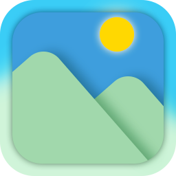
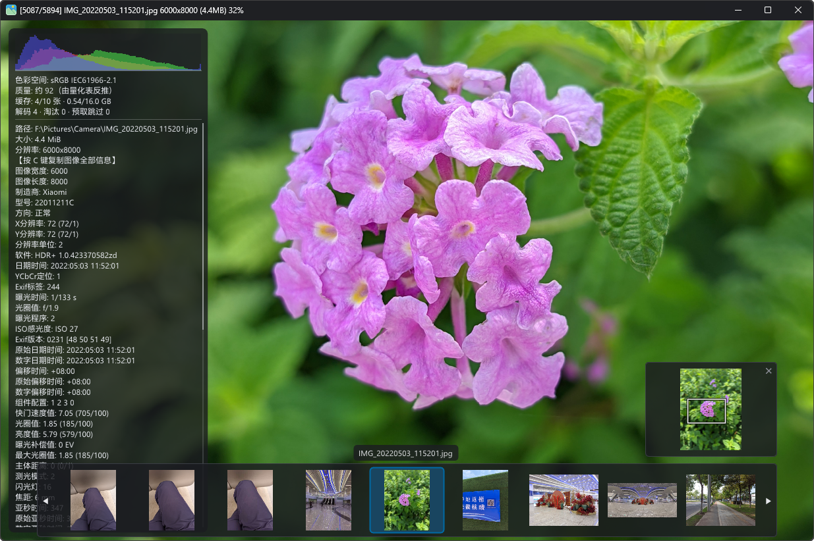
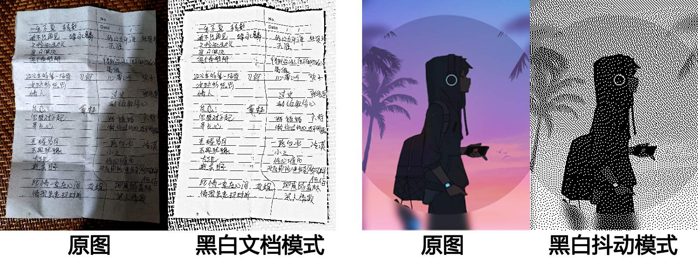

<p align="center">
  
</p>

<h1 align="center">🖼️ JarkViewer</h1>

<p align="center">
  <a href="https://github.com/jark006/JarkViewer/releases"></a>
  <a href="https://github.com/jark006/JarkViewer/releases"></a>
  
  <a href="LICENSE"></a>
  <a href="https://deepwiki.com/jark006/JarkViewer"></a>
  <a href="https://zread.ai/jark006/JarkViewer" target="_blank"></a>
</p>

<p align="center">
  <a href="README.md">中文</a> | English
</p>

**JarkViewer** is a native Windows image viewer with editing, annotation, batch processing and video / audio playback.

<p align="center">
  <a href="https://github.com/jark006/JarkViewer/releases/latest"><strong>Download the latest release</strong></a> ·
  <a href="#-installation-and-system-requirements">Installation</a> ·
  <a href="#-everyday-controls">Controls</a> ·
  <a href="#-format-support">Supported formats</a>
</p>

## ✨ Highlights

- **Portable**: one standalone executable, no installation; releases from `v2.0` onward need no additional VC++ runtime.
- **Broad format support**: JPEG / PNG, HEIC / AVIF / JPEG XL, camera RAW, animations and Live Photos.
- **Large-image browsing**: background decoding, thumbnail and neighbour preloading, and resampling at display resolution once the view settles.
- **Color and metadata**: ICC color management, EXIF, and AI generation prompts and workflows.
- **Editing and batch processing**: crop, annotate, convert formats, resize, rotate and rename.
- **Media playback**: a standalone video / audio player with hardware video decoding, seeking and an audio spectrum display.



Main window: EXIF information on the left, folder thumbnails at the bottom, and the navigator in the bottom-right corner.

## 🚀 Installation and system requirements

Supports **Windows 10 / 11 x64**. Choose any one of the following three options.

### 📥 Direct download

Download `JarkViewer.exe` from [GitHub Releases](https://github.com/jark006/JarkViewer/releases/latest) and run it. Extract compressed packages first.

Alternative downloads: [SourceForge mirror](https://sourceforge.net/projects/jarkviewer.mirror/), [Lanzou Cloud](https://jark006.lanzout.com/b0ko7mczg), [Baidu Cloud](https://pan.baidu.com/s/1ka7p__WVw2du3mnOfqWceQ?pwd=6666) (cloud extraction code: `6666`).

The main executable runs on its own. File Explorer thumbnails require the bundled `JarkThumbnailProvider.dll` in the same folder; see [File management and format association](#-file-management-and-format-association) for registration.

### 📦 Winget

```powershell
winget install jark006.jarkviewer
```

### 🥄 Scoop

```powershell
scoop bucket add extras
scoop install extras/jarkviewer
```

<details>
<summary>🖥️ Older systems and runtime requirements</summary>

- Windows 8 / 8.1 x64 has been tested, but compatibility with future releases is not guaranteed.
- 32-bit systems, Windows 7 and earlier versions are not supported.
- Since `v2.0`, all dependencies are statically linked: no additional VC++ runtime is needed, and the application can also run in Windows PE. If a DLL is reported missing, check that you downloaded the correct release build.

</details>

## 🧭 Everyday controls

Drag an image into the window, use `Ctrl + O`, or pass a file path on the command line. When several files are dropped together, only the first is opened. You can then browse images in the same folder.

| Action | How |
| --- | --- |
| Next / previous image | `←` `→`, or click / use the wheel on the left or right window edge |
| Zoom | Wheel in the window center; numpad `5` toggles between 1:1 and fit-to-window |
| Pan | Mouse drag, or `W` `A` `S` `D` |
| Image info (EXIF) | Middle click, `TAB` or `I` |
| Fullscreen | Double-click the window, `F` or `F11` |
| Quit | `ESC` or `Ctrl + W` |

<details>
<summary>⌨️ All image-viewing controls and shortcuts</summary>

| Action | How |
| --- | --- |
| Next / previous image | `Click/Wheel` on the left/right window edge, `←` `→`, `PgUp` `PgDn`, `Space` (next image when a still image is shown) |
| Zoom | `Wheel` in the window center, `↑` `↓`; `5` (numpad `5`) toggles between 1:1 and fit-to-window |
| Rotate | `Click/Wheel` on the top-left or top-right corner, `Q` `E` |
| Pan | Mouse drag, `W` `A` `S` `D`; enable **Settings → General → Reverse WASD panning** to reverse keyboard panning |
| Image info (EXIF) | `Middle click`, `TAB` or `I` |
| Fullscreen | `Double-click the window`, `F`, `F11` |
| Slideshow | `P` (`ESC` stops it); order and interval are in Settings |
| Frame-by-frame (animations) | Top control bar, `J` previous `K` pause/resume `L` next |
| First / last image | `Home` / `End` |
| Delete | `Delete` (moves to the recycle bin; the confirmation can be turned off in Settings) |
| Open an image | `Ctrl + O`, or drag a file into the window (when several are dropped only the first is used; you can page through the folder afterwards) |
| Copy image | `Ctrl + C` |
| Print | `Click` the bottom-left corner, `Ctrl + P` |
| Edit and annotate | `Ctrl + E` |
| Batch processing | `Ctrl + B` |
| Rename | `Ctrl + R` |
| Split an animation | `Ctrl + S` saves every frame as a separate PNG |
| Settings | `F1` General, `F2` File association, `F3` Help, `F4` About |
| Quit | `ESC`, `Ctrl + W` |

</details>

The Help page in Settings (`F3`) also provides a shortcut reference.

### 🔎 Browsing features

- **Thumbnail strip**: hover near the bottom edge to show thumbnails from the same folder. Use the wheel or arrow keys to browse, or click to switch images; the strip hides when the pointer moves away.
- **Navigator**: the bottom-right panel shows the whole image and the visible area. Drag the box to move around, hide it with `✕`, or toggle it in Settings.
- **Display and window**: transparent areas use a checkerboard background. Window position, size, fullscreen / maximized state and monitor are remembered and shared by the image viewer and player.
- **Languages and themes**: Simplified Chinese / Traditional Chinese / English / Japanese / Korean / Russian, following the system or selected manually, with light and dark themes.
- **Context menu**: copy EXIF / file path / image data, open the file location, and access file management, video export, printing, editing and other common actions.

## 🎬 Player (video / audio)

Open a video or audio file from the command line, drag-and-drop or the Open dialog to enter the standalone player window. Video and audio files are excluded from image browsing in the same folder.

Press `Space` to play / pause, use the wheel for volume, or drag the progress bar to seek. Video keyframes are previewed while dragging, with precise seeking on release.

<details>
<summary>🎮 All player controls and shortcuts</summary>

| Action | How |
| --- | --- |
| Play / pause | `Space`, or `click the picture` |
| ±5 seconds | `A` `D`, `←` `→` |
| Volume | `W` `S`, `↑` `↓`, `Wheel` |
| Single-frame stepping | `A` `D`, `←` `→` while paused (audio has no frames, so it jumps by 5 seconds) |
| Start / end | `Home` / `End` |
| Seek | Drag the progress bar (keyframe preview while dragging, exact landing on release) |
| Media info | `I` or `TAB` (path, size, duration, container, total bit rate, video/audio codec parameters) |
| Fullscreen | `Double-click the picture`, `F`, `F11` |
| Open another file | `Ctrl + O` (picking an image hands it back to the image viewer) |
| Quit | `ESC`, `Ctrl + W` |

</details>

- **Audio playback**: shows the file name, path and live spectrum, with the progress bar always visible.
- **End of playback**: stops on the last frame; press `Space` to restart from the beginning.
- **Hardware video decoding**: prefers the GPU and automatically falls back to software when unsupported or decoding fails. If you see corruption or flicker, try disabling "Hardware video decoding" in Settings → General to compare.

## 🖨️ Printing and editing

### ✏️ Editing and annotation

`Ctrl + E` opens the editor: rectangle, ellipse, arrow, line, brush, mosaic and text, with adjustable color, line width, font size and fill. Undo / redo, rotate / flip / invert and crop are also supported.

Save as a new file, copy to the clipboard or overwrite the original. PNG preserves transparency; transparent areas in JPG are flattened onto white.

### 📄 Print preview

Press `Ctrl + P` or click the bottom-left corner of the window to open print preview. Adjust brightness, contrast, inversion and color mode, then save an image file or continue printing.

- **Color / Gray**: color or grayscale output.
- **Document**: balances brightness, emphasizes text and reduces local shadows, suitable for photographed documents.
- **Dithering**: represents grayscale through the density of black pixels, suitable for dot-matrix and thermal printers.

Hover over the brightness or contrast slider to adjust it with the wheel: each notch changes the value by 1, within 0–200.



The left pair demonstrates Document mode; the right pair demonstrates Dithering. Each pair shows the original first, followed by the processed result.

## 🗂️ Batch processing

Press `Ctrl + B` to process images in the current folder:

- **Convert formats**: including HEIC / AVIF / RAW inputs, with JPEG, PNG, WebP, BMP, TIFF and other output formats.
- **Resize**: by percentage, width, height, custom dimensions (stretching allowed), or maximum long edge (shrink only). Auto resampling uses area averaging when shrinking and Lanczos when enlarging.
- **Rotate / flip**.
- **Rename**: prefix + index.
- **Adjust brightness, contrast and color mode**; choose an output folder or process in place, with optional overwriting of existing files.

## 📁 File management and format association

- **Rename** (`Ctrl + R`): changes the base name while preserving the extension; rejects empty names, invalid characters, reserved device names and duplicates.
- **Copy / move to a target folder**: change the destination at any time. Existing files are preserved by using names such as `name (2).ext`; cross-drive moves copy first and delete the source after a successful copy.
- **External editor**: open the current image in a program specified in Settings.
- **Move to recycle bin**: the confirmation prompt can be disabled in Settings.
- **Explorer thumbnails**: `JarkThumbnailProvider.dll` provides thumbnails for JXL / AVIF / HEIC and other formats. Select formats on the File association page in Settings and apply to register both associations and thumbnails. Thumbnail registration is skipped if the DLL is not beside the main executable.
- **File properties**: opens the system properties dialog.

## 📹 Live Photos and video export

- **Live Photos**: recognizes iOS `livp` and Android MicroVideo / MotionPhoto (`jpg` / `heic` / `heif`). Opening one plays it once, then returns to the still image; press `Space` to replay. "Play Live Photo sound automatically" controls audio and is off by default.
- **Export video**: use "Export video" in the context menu to save embedded video without re-encoding: `.mov` from `livp`, or the trailing MP4 in Android Motion Photos. Directly opened video files can also be exported.

## 📂 Format support

| Type | Common formats |
| --- | --- |
| Images | JPEG, PNG, WebP, HEIC, AVIF, JPEG XL, SVG, PSD / PSB and more |
| Animations | GIF, WebP, APNG, JPEG XL, AVIF |
| Live Photos | iOS LIVP, Android MotionPhoto / MicroVideo |
| RAW | Canon CR2 / CR3, Nikon NEF, Sony ARW, DNG and more |
| Video and audio | MP4, MKV, MOV, MP3, FLAC, WAV and more |

<details>
<summary>📋 Complete extension lists</summary>

- **Static**: `apng avif avifs blp bmp dds dib exr gif hdr heic heif ico icon jfif jp2 jpe jpeg jpg jxl jxr lep livp pbm pcx pfm pgm pic png pnm ppm psb psd psdt pxm qoi ras sr svg tga tif tiff webp wp2`
- **Animated**: `gif webp png apng jxl avif`
- **Live**: `livp (iOS Live Photo) jpg/heic/heif (Android MicroVideo/MotionPhoto)`
- **Video**: `3gp avi evo flv m2ts m4v mkv mov mp4 mts mxf ts vob webm wmv`
- **Audio**: `aac ac3 aif aiff amr ape au caf dsf dts flac m4a m4b mka mp2 mp3 mpc oga ogg opus tak tta w64 wav wma wv`
- **RAW**: `3fr ari arw bay cap cr2 cr3 crw dcr dcs dng drf eip erf fff gpr iiq k25 kdc mdc mef mos mrw nef nrw orf pef ptx r3d raf raw rw2 rwl rwz sr2 srf srw x3f`

</details>

<details>
<summary>🧩 PSD / PSB compatibility</summary>

PSD / PSB prefers the saved compatibility composite. It supports 8/16-bit RGB, grayscale and CMYK (with embedded ICC color conversion), plus Raw, RLE, ZIP and ZIP prediction compression.

Without a saved composite, ordinary RGB layers can be composited with visibility, offsets, transparency and layer opacity preserved. Files with groups, masks, adjustment layers, layer effects or special blend modes still need to be saved in Photoshop with "Maximize Compatibility" enabled.

</details>

## 💡 FAQ

### 🎨 Why do the colors look wrong?

ICC color management is enabled by default. It converts images from their embedded profile to the monitor's ICC profile, falling back to sRGB when a valid monitor profile is unavailable. Conversion to a narrower gamut may map or clip some colors.

To compare the display without color conversion, temporarily disable "ICC Color Management" in Settings → General.

### 🖼️ Why are File Explorer thumbnails missing?

Make sure `JarkThumbnailProvider.dll` is beside the main executable, then select formats on the File association page in Settings and apply. See [File management and format association](#-file-management-and-format-association).

### 🤖 Where are the AI generation prompts?

Press the middle mouse button, `TAB` or `I` to open the EXIF panel and view prompts or workflow JSON written by StableDiffusion WebUI / ComfyUI. This metadata may be removed when an online platform re-encodes the image.

### 🧠 Will memory usage keep growing? Why does browsing sometimes pause?

The cache evicts entries as needed, but large images can still use substantial memory. Uncached images take time to decode. Press `TAB` or the middle mouse button to see cache usage at the top of the EXIF panel.

<details>
<summary>💾 Cache budget and large-image preloading</summary>

- The default cache limit is 10 entries, with a budget of half of physical RAM.
- Images still in use are kept, and at least 2 entries remain. Large images or images used by other features can therefore temporarily take the cache over budget. Total application memory also includes the canvas, playback buffers and other data.
- Images that decode to several GB skip neighbour preloading; opening an uncached image still requires decoding.
- The EXIF panel also shows the cache budget, decode count, evictions and prefetch skips.

</details>

## 🛠️ Development and project resources

See the [developer documentation](docs/README.md) (in Chinese) for building, testing and module details, and [AGENTS.md](AGENTS.md) for AI collaboration rules.

Project guides and Q&A: [DeepWiki](https://deepwiki.com/jark006/JarkViewer) · [Zread](https://zread.ai/jark006/JarkViewer).

## 📜 License

This project is open source under the [GPL-3.0 License](LICENSE).
